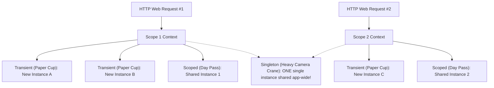

# Topic 21: .NET Platform Architecture & Dependency Injection

## 🌟 The Story: The Hollywood Film Set & The Prop Master

To build massive, maintainable enterprise software, you must eliminate hardcoded class dependencies. The architectural design pattern that powers the entire .NET ecosystem is **Inversion of Control (IoC)** through **Dependency Injection (DI)**.

### 1. The Actor and The Prop Master (Constructor Injection)
Imagine a Hollywood movie set:
- An actor plays a secret agent. In the script, the agent needs a fast sports car.
- **The Amateur Actor (`new` Keyword):** The actor walks off the set, drives to a car dealership, buys an expensive Ferrari with cash, drives it onto the stage, and then tries to sell it when the scene finishes:
  ```csharp
  // Tight coupling disaster:
  public class SecretAgent {
      private Ferrari _car = new Ferrari(); // Hardcoded dependency!
  }
  ```
  What happens when the script changes to an underwater submarine scene? The actor's code must be rewritten!
- **The Hollywood Pro (Dependency Injection):** The actor merely declares their need in their contract: *"I need any vehicle that implements `IVehicle`."*
  ```csharp
  public class SecretAgent {
      private readonly IVehicle _vehicle;
      public SecretAgent(IVehicle vehicle) => _vehicle = vehicle; // Constructor Injection!
  }
  ```
  The **Master Prop Master (The .NET DI Container)** inspects the contract and injects the vehicle. During rehearsals, the Prop Master injects a cheap cardboard golf cart (`MockVehicle`). During filming, the Prop Master injects an exotic Aston Martin. The actor's performance code **never changes a single line**!

---

### 2. The 3 Service Lifetimes: The Coffee Cup, The Day Pass, and The Crane



| Lifetime | Method | How It Behaves in Memory | Best Suited For |
|---|---|---|---|
| **Transient** | `AddTransient<T, Impl>()` | A brand-new instance is instantiated **every single time** it is requested. | Lightweight, stateless utilities (parsers, formatters, calculators). |
| **Scoped** | `AddScoped<T, Impl>()` | A single instance is instantiated **once per HTTP request / scope**, shared across all services in that request, and disposed when the request finishes. | Entity Framework `DbContext`, user identity sessions, shopping carts. |
| **Singleton** | `AddSingleton<T, Impl>()` | Created **once** on application boot and kept alive on the Heap for the entire lifetime of the process. | In-memory caches, configuration providers, background task queues. |

---

## 🔬 The Technical Deep Dive

### 1. The Generic Host (`IHost`) & Configuration Hierarchy
Modern .NET applications run inside a **Generic Host** (`IHost`). It automatically coordinates:
- **Dependency Injection Container (`IServiceProvider`)**
- **Configuration Hierarchy (`IConfiguration`):** Merges settings in strict precedence:
  1. `appsettings.json` (Base defaults)
  2. `appsettings.{Environment}.json` (e.g. Development vs. Production)
  3. User Secrets (Local development secrets)
  4. Environment Variables (Docker / Kubernetes container secrets)
  5. Command-Line Arguments (Overrides at launch)
- **Structured Logging (`ILogger<T>`):** Emits structured telemetry with log levels: `Trace`, `Debug`, `Information`, `Warning`, `Error`, `Critical`.
