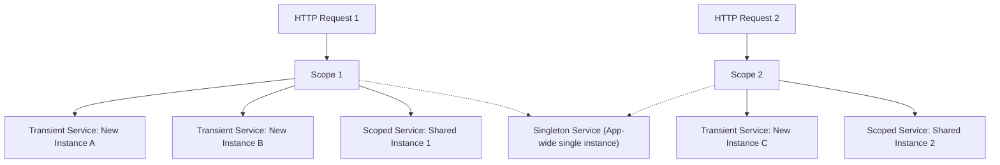

# Topic 21: .NET Platform Architecture & Dependency Injection

## 📖 Theoretical Overview

### 1. Inversion of Control (IoC) & Dependency Injection (DI)
Dependency Injection is a design pattern where an object receives its dependencies from an external assembler (the IoC container) rather than instantiating them directly with `new`.

### 2. Service Lifetimes in .NET
| Lifetime | Resolution Behavior | Best Suited For |
|---|---|---|
| **Transient** (`AddTransient`) | A new instance is created every single time it is requested | Lightweight, stateless services |
| **Scoped** (`AddScoped`) | A single instance is created once per HTTP request / scope | Entity Framework `DbContext`, user context |
| **Singleton** (`AddSingleton`) | Created once on first request; shared across entire application lifetime | In-memory cache, background workers |

---

## 📊 Dependency Injection Lifetimes

