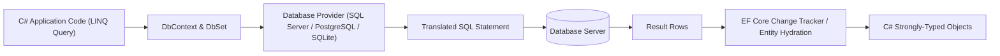

# Topic 22: Database Development (ADO.NET & EF Core)

## 📖 Theoretical Overview

### 1. Data Access Paradigms in .NET
- **ADO.NET (`SqlConnection`, `SqlCommand`):** Low-level, high-control data access. Requires manual mapping of `SqlDataReader` rows to objects.
  - *Golden Rule:* Always use **Parameterized Queries** (`cmd.Parameters.AddWithValue`) to prevent SQL Injection attacks.
- **Dapper:** Micro-ORM that extends `IDbConnection` with fast auto-mapping while allowing raw SQL execution.
- **Entity Framework Core (EF Core):** Full-featured Object-Relational Mapper (ORM). Maps C# classes (`Entities`) to database tables via a `DbContext`.

### 2. EF Core Key Concepts
- **Change Tracker:** Monitors entity mutations in memory and generates optimized `INSERT`/`UPDATE`/`DELETE` SQL statements when `SaveChanges()` is called.
- **`AsNoTracking()`:** Disables the change tracker for read-only queries, drastically reducing memory overhead and boosting query performance.

---

## 📊 EF Core Data Flow Architecture

