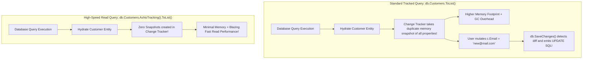
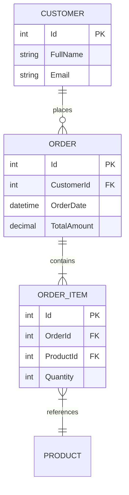

# Topic 22: Database Development (ADO.NET & Entity Framework Core)

## 🌟 The Story: The Bank Teller, The SQL Hacker & The Master Scribe

How your application talks to relational databases (SQL Server, PostgreSQL, MySQL, SQLite) determines both its security and its throughput.

### 1. The Naive Bank Teller vs. The SQL Injection Hacker
Imagine a bank teller who accepts withdrawal slips:
- **The Catastrophic Vulnerability (Raw String Concatenation):**
  A malicious user enters this as their username:
  ```text
  ' OR '1'='1'; DROP TABLE Accounts; --
  ```
  If your code stitches SQL queries together using string interpolation:
  ```csharp
  // FATAL SECURITY HOLE!
  string sql = $"SELECT * FROM Users WHERE Username = '{input}' AND Password = '{password}'";
  ```
  The database executes the malicious payload as real instructions: it validates the user as true, deletes the entire `Accounts` table, and shuts down the business.
- **The Parameterized Armor (ADO.NET Parameters):**
  ```csharp
  cmd.CommandText = "SELECT * FROM Users WHERE Username = @username";
  cmd.Parameters.AddWithValue("@username", input); // Treated strictly as inert literal data!
  ```
  The database compiles the query structure *before* evaluating the parameter. The injection attack is rendered completely powerless.

---

### 2. The Manual Stenographer vs. The Digital Twin (ADO.NET vs. EF Core)
- **ADO.NET (`SqlConnection`, `SqlCommand`, `SqlDataReader`):** You write raw SQL strings, manage connection state, loop through table rows, and cast columns manually. It provides raw bare-metal speed and maximum control.
- **Entity Framework Core (EF Core):** A full Object-Relational Mapper (ORM). You interact with strongly-typed C# domain models (`DbSet<Customer>`). EF Core generates the SQL, handles database migrations, maps foreign key relationships, and tracks mutations automatically.

---

## 🔬 The Technical Deep Dive

### 1. The EF Core Change Tracker & `AsNoTracking()`



> 💡 *Golden Rule:* For any read-only scenario (e.g. rendering web API endpoints, export reports, search results), **always append `.AsNoTracking()`**.

---

### 2. Entity Relationships & Navigation Properties



- **Eager Loading (`.Include(c => c.Orders)`):** Loads related entities in a single SQL `JOIN` query, eliminating the disastrous **N+1 Query Problem**.
- **Unit of Work Pattern:** Maintains a list of business transactions and coordinates the writing of changes in a single atomic database transaction.
