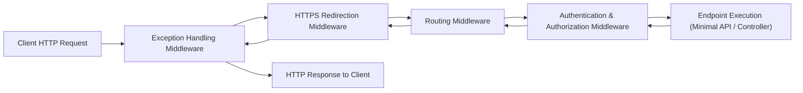

# Topic 23: Web Development with ASP.NET Core

## 📖 Theoretical Overview

### 1. The ASP.NET Core Request Pipeline & Middleware
ASP.NET Core processes HTTP requests through a chain of **Middleware** components. Each middleware can inspect, short-circuit, or pass the request forward (`next()`), and process the outgoing response.

### 2. Minimal APIs vs. Controllers
- **Controllers:** Traditional class-based structure (`[ApiController]`) grouping related endpoints under common routes and dependency injection scopes.
- **Minimal APIs (Modern C#):** Ultra-fast, lightweight route declarations (`app.MapGet("/", () => ...);`) with minimal ceremony and reduced memory footprint.

### 3. REST Conventions & HTTP Verbs
- `GET`: Safe, idempotent retrieval of resources.
- `POST`: Non-idempotent creation of new resources.
- `PUT`: Idempotent full replacement/update of an existing resource.
- `DELETE`: Removal of an existing resource.

---

## 📊 ASP.NET Core Middleware Pipeline

