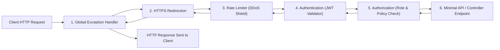

# Topic 23: Web Development with ASP.NET Core & REST Architecture

## 🌟 The Story: The Airport Security Tunnel & The Cryptographic Passport

Modern web APIs built with ASP.NET Core power high-scale cloud microservices worldwide. To understand how web requests flow through the framework, picture an international airport security corridor:

### 1. The Russian Nesting Dolls (The Middleware Pipeline)
When an HTTP request enters an ASP.NET Core application, it does not jump directly into a controller or endpoint. It must pass through a sequential chain of bidirectional gates known as **Middleware**:



Each middleware component can:
1. Inspect or modify the incoming `HttpContext`.
2. **Short-Circuit** the pipeline (e.g. if the user has no token, Gate 4 returns `401 Unauthorized` immediately without ever waking up the database or controller!).
3. Pass control to the next component via `await next(context)`.
4. Process outgoing responses on the way back out!

---

### 2. The Cryptographic Passport (JWT Bearer Tokens)
In traditional web servers, the server saved session state in server RAM. In modern cloud clusters with 50 load-balanced servers, user requests land on different machines constantly.
- **The Solution:** A **JSON Web Token (JWT)**.
- When a user logs in, the authentication server signs a tamper-proof token containing **Claims** (`sub: "kunal"`, `role: "Admin"`).
- The client sends this token in the HTTP `Authorization: Bearer <token>` header with every request.
- Every server in the cluster validates the mathematical digital signature in microseconds **without making a single database call**!

---

## 🔬 The Technical Deep Dive

### 1. Controllers vs. Minimal APIs

| Dimension | Minimal APIs (C# 10+) | Controller-Based APIs |
|---|---|---|
| **Architecture** | Endpoint-centric, functional lambda mapping | Class-centric (`[ApiController]`), inheritance-based |
| **Boilerplate** | Near Zero (Ideal for microservices and cloud functions) | Moderate (Requires controllers, actions, attributes) |
| **Startup Speed** | Blazing fast (Reduced reflection scan overhead) | Slower (Scans assembly for controller types) |
| **Memory Footprint**| Lowest possible allocation overhead | Standard ASP.NET Core allocation |

#### Minimal API Example:
```csharp
var builder = WebApplication.CreateBuilder(args);
var app = builder.Build();

app.MapGet("/api/products/{id:int}", (int id, IProductService svc) => 
    svc.Find(id) is Product p ? Results.Ok(p) : Results.NotFound());

app.Run();
```

---

### 2. DTOs & Defensive Model Validation
Never accept raw database entities directly in HTTP request payloads. This invites **Over-Posting Security Attacks** where malicious users inject unexpected fields (e.g. `IsAdmin: true`).

Always accept dedicated **Data Transfer Objects (DTOs)** decorated with System.ComponentModel.DataAnnotations:
```csharp
public record RegisterUserDto(
    [Required, StringLength(50, MinimumLength = 3)] string FullName,
    [Required, EmailAddress] string Email,
    [Range(18, 120)] int Age
);
```
