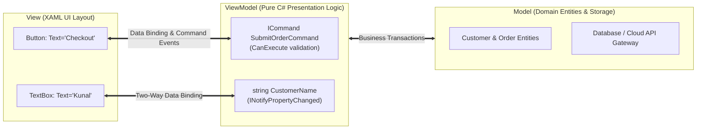

# Topic 24: Desktop & Cross-Platform UI (.NET MAUI, WPF & MVVM)

## 🌟 The Story: The Puppet Master & The Stage Marionette

When building graphical user interfaces across desktop and mobile devices, coupling UI buttons directly to business logic results in unmaintainable spaghetti code. The gold standard pattern in .NET is **MVVM (Model-View-ViewModel)**.

### 1. The Stage Marionette (The View / XAML)
Picture a theatrical marionette puppet on stage:
- The puppet is made of carved wood, fabric, and paint (**The View / XAML UI**).
- The puppet has **zero brain of its own**. It has no idea what a SQL database is, cannot process credit cards, and does not perform arithmetic. Its only job is to look good under the stage lights and display positions to the audience.

---

### 2. The Puppet Strings (Two-Way Data Binding)
Connecting the puppet to the puppeteer are responsive, invisible strings (**Data Binding**):
- When the puppeteer raises his finger, the puppet's arm raises instantly (**`INotifyPropertyChanged`** notification from ViewModel to View).
- When a child in the audience gently pulls the puppet's hand, the string moves the puppeteer's finger (**Two-Way Binding** from View back to ViewModel).

---

### 3. The Puppeteer Behind the Curtain (The ViewModel)
The puppeteer standing above the stage is the **ViewModel**. 
- The ViewModel holds the active state: the user's name, the shopping cart items, whether the "Submit" button is currently enabled.
- When the user clicks the "Pay Now" button, the puppet does not run code in an old-fashioned `Button_Click` event handler. Instead, the button pulls an **`ICommand`** string connected to the ViewModel.
- **The Ultimate Payoff:** Because the puppeteer is completely separated from the wooden puppet, you can replace the wooden puppet with a **Windows Desktop App (WPF)**, an **iPhone App (iOS MAUI)**, or an **Android Tablet App**, and the **exact same ViewModel and Model code runs unchanged without modifying a single line of business logic**!

---

## 🔬 The Technical Deep Dive

### 1. The MVVM Triad Architecture

---

### 2. The Core Mechanics: `INotifyPropertyChanged` and `ICommand`
- **`INotifyPropertyChanged`:** An interface with a single event `PropertyChanged`. When a property setter updates a field, it raises this event. The XAML engine hears the event and updates the screen instantly.
- **`ICommand`:** Replaces click events with testable command objects. It exposes two methods:
  - `bool CanExecute(object? parameter)`: Disables or enables the UI button automatically based on state!
  - `void Execute(object? parameter)`: Runs the business action.

---

### 3. Cross-Platform Unification: .NET MAUI
**.NET MAUI (Multi-platform App UI)** compiles a single C# codebase into native apps:
- **Windows:** Compiles to WinUI 3.
- **macOS:** Compiles to Mac Catalyst.
- **iOS & Android:** Compiles to native iOS UIKit and Android Views with native hardware performance!
