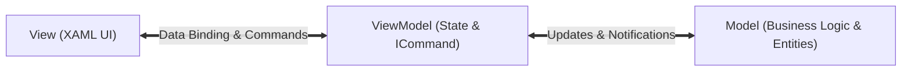

# Topic 24: Desktop & Cross-Platform UI (.NET MAUI, WPF & MVVM)

## 📖 Theoretical Overview

### 1. UI Frameworks in the .NET Ecosystem
- **Windows Forms:** Event-driven, GDI+ based classic Windows desktop framework.
- **WPF (Windows Presentation Foundation):** Hardware-accelerated desktop framework using **XAML** for declarative UI and vector graphics.
- **.NET MAUI (Multi-platform App UI):** Modern cross-platform framework that compiles a single C# codebase into native desktop (Windows, macOS) and mobile apps (iOS, Android).

### 2. The MVVM (Model-View-ViewModel) Pattern
- **Model:** Business data and domain logic.
- **View:** User interface layout declared in XAML (strictly decoupled from logic).
- **ViewModel:** Acts as an intermediary; exposes state and commands (`ICommand`) to the View via **Two-Way Data Binding** and `INotifyPropertyChanged`.

---

## 📊 MVVM Architecture

