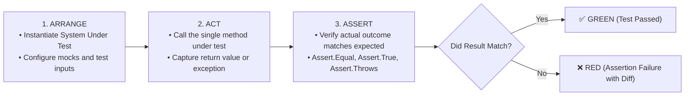

# Topic 25: Automated Unit Testing with xUnit

## 🌟 The Story: The Automotive Crash Test Lab & The Certified Stunt Dummy

How do aerospace and automotive companies guarantee that passenger jets and electric vehicles are safe before human passengers climb aboard?

### 1. Manual Testing in Production vs. The Crash Test Rig
- **The Amateur Approach:** An engineer changes the code for the anti-lock brakes, deploys it straight to the customer's vehicle, and hopes the customer doesn't crash on an icy highway.
- **The Engineering Master Approach:** Every night, an automated robotic rig runs 10,000 simulated collisions:
  - It tests freezing blizzards, wet gravel, sudden blowouts, and emergency swerves.
  - If a single sensor reading fails an assertion, the build turns **RED**, and the software is blocked from ever reaching production.
- **xUnit** is your automated crash-test laboratory. It runs hundreds of deterministic unit tests in parallel in milliseconds, giving you ironclad confidence that refactoring your code broke zero existing features!

---

### 2. The Universal Testing Cadence: Arrange - Act - Assert (AAA)

Every clean unit test is structured into three distinct, unambiguous phases:



---

## 🔬 The Technical Deep Dive

### 1. `[Fact]` vs. `[Theory]` in xUnit

| Attribute | Test Nature | Input Data Source | Purpose |
|---|---|---|---|
| **`[Fact]`** | Invariant Scenario | Fixed (Hardcoded inside the test body) | Testing an architectural invariant (e.g. `DivideByZero_ThrowsException`). |
| **`[Theory]`** | Data-Driven / Parameterized | Supplied via `[InlineData]` or `[MemberData]` | Running the **exact same assertion logic** across 10, 20, or 100 diverse inputs and boundary conditions. |

```csharp
// [Theory] runs 3 times with different permutations:
[Theory]
[InlineData(10, 2, 5.0)]
[InlineData(7, 2, 3.5)]
[InlineData(-9, 3, -3.0)]
public void Divide_ValidNumbers_ReturnsExpectedQuotient(int a, int b, double expected)
{
    var calc = new Calculator();
    double actual = calc.Divide(a, b);
    Assert.Equal(expected, actual, precision: 2);
}
```

---

### 2. Industry Test Naming Convention
A test name should read like a living specification document:
> `UnitOfWork_StateUnderTest_ExpectedBehavior`

- ✅ `Add_TwoPositiveIntegers_ReturnsTheirSum`
- ✅ `Withdraw_AmountExceedsBalance_ThrowsInsufficientFundsException`
- ❌ `Test1`, `CalculatorTest`, `CheckMath` (Provides zero diagnostic value when a CI/CD build fails!)

---

### 3. Testing Exceptions via `Assert.Throws`
Never use an empty `try/catch` inside a test to check for exceptions! xUnit provides a dedicated, functional assertion:

```csharp
[Fact]
public void Divide_ByZeroDenominator_ThrowsDivideByZeroException()
{
    var calc = new Calculator();
    
    // Asserts that the lambda throws the exact expected exception type:
    Assert.Throws<DivideByZeroException>(() => calc.Divide(10, 0));
}
```

---

### 4. Running Tests in CLI & Generating Code Coverage
```powershell
# Run all tests in the solution:
dotnet test

# Detailed test-by-test console logger:
dotnet test --logger "console;verbosity=normal"

# Collect cross-platform code coverage:
dotnet test --collect:"XPlat Code Coverage"
```
