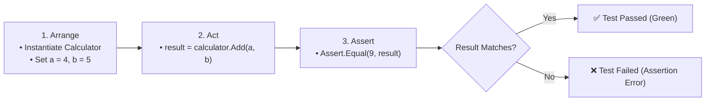

# Topic 25: Automated Unit Testing with xUnit

## 📖 Theoretical Overview

### 1. The Anatomy of a Unit Test: AAA Pattern
- **Arrange:** Set up prerequisites, instantiate objects, define inputs.
- **Act:** Execute the single behavior or method under test.
- **Assert:** Verify that the actual outcome matches the expected value.

### 2. `[Fact]` vs. `[Theory]` in xUnit
- **`[Fact]`:** Tests an invariant scenario with fixed inputs. Runs once.
- **`[Theory]`:** A parameterized test executed multiple times across different data sets provided via `[InlineData]` or `[MemberData]`.

### 3. Testing Exceptions
Use `Assert.Throws<TException>(() => action)` to verify that expected exceptions are thrown under boundary/invalid conditions.

---

## 📊 Arrange - Act - Assert (AAA) Test Pipeline

