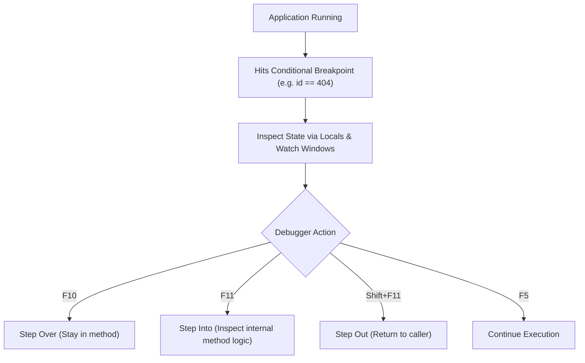

# Topic 26: Debugging & Runtime Diagnostics

## 📖 Theoretical Overview

### 1. Essential Debugger Controls
- **F9 (Toggle Breakpoint):** Pauses execution at a specific line.
- **Conditional Breakpoint:** Pauses only when a condition evaluates to true (e.g. `i == 95` or `userId == null`).
- **F10 (Step Over):** Executes the current line and pauses at the next line in the current method.
- **F11 (Step Into):** Jumps inside the called method's implementation.
- **Shift+F11 (Step Out):** Finishes executing the current method and pauses in the calling method.

### 2. Diagnostic Windows
- **Locals:** Displays all variables currently active in the immediate lexical scope.
- **Watch:** Evaluates custom C# expressions dynamically while paused.
- **Call Stack:** Displays the hierarchy of active method frames leading up to the current breakpoint.

---

## 📊 Debugging & Diagnostic Pipeline

