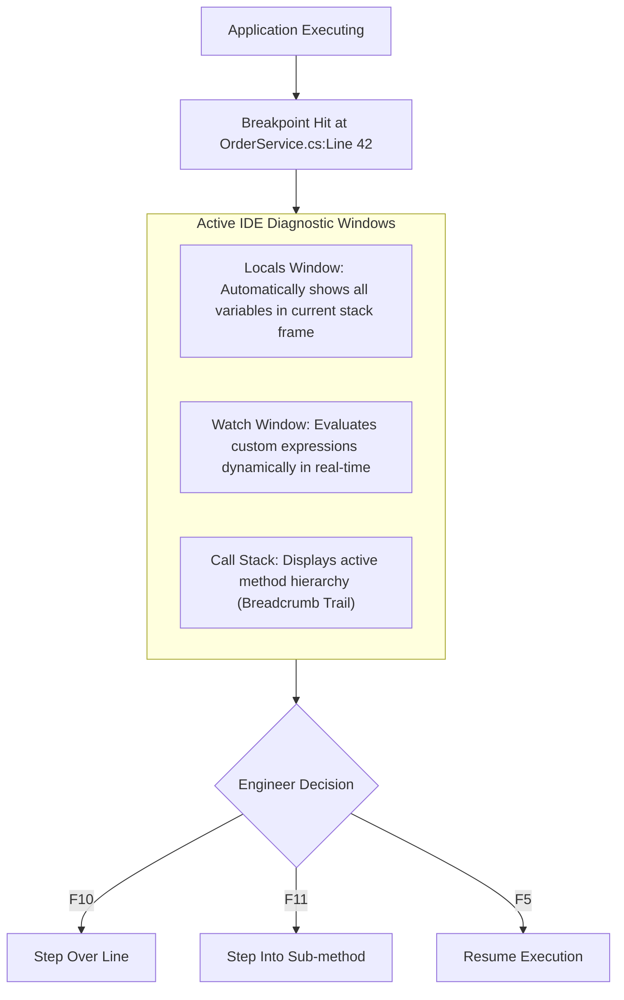

# Topic 26: Debugging, Diagnostics & Performance Profiling

## 🌟 The Story: The Hospital ICU Monitor & The Time-Freezing Surgeon

Writing code is only half of software engineering. The other half is diagnosing subtle bugs, investigating production outages, and eliminating performance bottlenecks.

### 1. The ECG Heart Monitor (Non-Invasive Diagnostics)
Imagine a patient in an intensive care unit:
- A doctor does not perform invasive open-heart surgery just to check if the heart is beating.
- Instead, the medical team connects non-invasive sensors: an ECG monitor, an oxygen saturation pulse oximeter, and blood pressure telemetry (**Logging, Tracing & Metrics**).
- In modern .NET, **`Stopwatch`**, **`Activity` (Distributed Tracing)**, and **`DiagnosticSource`** provide high-precision telemetry with near-zero performance penalty.

---

### 2. The Surgeon's Time Freeze (Breakpoints & Stepping Controls)
Imagine you had the supernatural ability to freeze time in the operating room:

| Debugger Action | Keyboard Shortcut | Real-World Medical Analogy |
|---|---|---|
| **Toggle Breakpoint** | **`F9`** | Freezes application execution the moment this specific line of code is reached. |
| **Conditional Breakpoint** | *(Right-Click Breakpoint)* | Freeze time **only if a specific condition is met** (e.g. `userId == 404` or `loopIndex == 9999`). Spares you from pressing "Continue" 10,000 times! |
| **Step Over** | **`F10`** | Executes the current line of code and pauses immediately at the next line in the current method. |
| **Step Into** | **`F11`** | Jumps inside the called method's implementation to inspect its inner logic line by line. |
| **Step Out** | **`Shift + F11`** | Finishes executing the current method and pauses immediately in the calling method. |

---

## 🔬 The Technical Deep Dive

### 1. Diagnostic Windows: Watch, Locals & Call Stack

- **Locals Window:** Automatically populates with all variables declared in the current method frame.
- **Watch Window:** Allows you to type arbitrary C# expressions (e.g. `order.Items.Count > 0`, `user.IsAdmin`) to evaluate them dynamically while paused!
- **Call Stack:** Displays the chronological chain of method calls that led to the current line:
  `OrderService.SubmitOrder() -> PaymentGateway.Authorize() -> DatabaseContext.SaveChanges()`.

---

### 2. Diagnosing Memory Leaks (The GC Root Trail)
Why do memory leaks happen in a garbage-collected language like C#?

An object **cannot be garbage collected** as long as there is an unbroken chain of references connecting it to a **GC Root**:
1. **Static Fields:** Static collections (`static List<byte[]> Cache`) live for the entire process lifetime. Anything added to them is pinned forever.
2. **Unsubscribed Event Handlers:** Long-lived publishers hold strong references to subscribers.
3. **Thread-Local Variables:** Variables stored in active worker threads.

#### Production Diagnostics Tools:
- **`dotnet-trace`:** Captures CPU performance profiles and hot paths.
- **`dotnet-dump`:** Captures full memory snapshots of live production crashes.
- **`dotnet-counters`:** Live terminal dashboard monitoring GC allocation rates and CPU usage.
